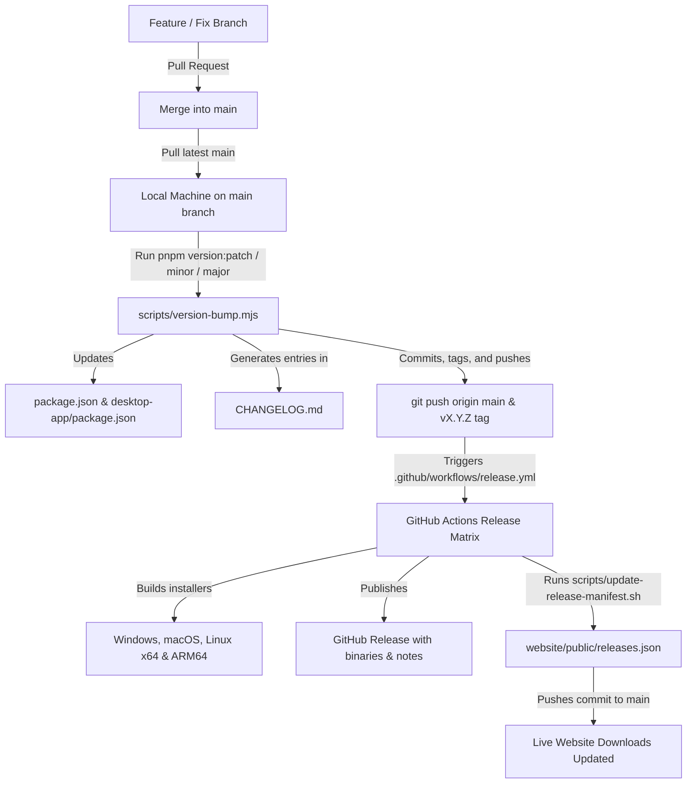

# Release Guide

This guide details the complete end-to-end process for releasing a new version of **Sky Movie**. It covers creating a pull request, running the automated version bump script, what files get updated, how GitHub Actions builds release binaries across platforms, and how the website release manifest is updated.

---

## Table of Contents

1. [Overview & Architecture](#overview--architecture)
2. [Step 1: Feature Development & PR Flow](#step-1-feature-development--pr-flow)
3. [Step 2: Pre-Release Verification](#step-2-pre-release-verification)
4. [Step 3: Run the Version Bump Script](#step-3-run-the-version-bump-script)
5. [Step 4: Automated CI/CD Release Build](#step-4-automated-cicd-release-build)
6. [Step 5: Post-Release Verification & Local Sync](#step-5-post-release-verification--local-sync)
7. [Alternative Release Methods](#alternative-release-methods)
8. [Troubleshooting & Rollback](#troubleshooting--rollback)
9. [Quick Reference Cheat Sheet](#quick-reference-cheat-sheet)

---

## Overview & Architecture

Sky Movie is a monorepo containing:
- `desktop-app/`: The Electron + React + SQLite desktop client.
- `website/`: The Next.js landing and download site.
- `scripts/`: Release, packaging, and version management scripts.



### Key Versioned Files

During a release, three core files are updated:
1. `package.json`: Workspace root version (`"version": "X.Y.Z"`).
2. `desktop-app/package.json`: Desktop application version (`"version": "X.Y.Z"`).
3. `CHANGELOG.md`: Markdown changelog categorized into *Added*, *Changed*, *Fixed*, and *Other*.
4. `website/public/releases.json`: Release manifest containing download links, file sizes, and release metadata (updated automatically by CI).

---

## Step 1: Feature Development & PR Flow

All changes and bug fixes should go through a Pull Request before releasing.

### 1. Create a Branch

Start from an up-to-date `main` branch:

```bash
git checkout main
git pull origin main
git checkout -b feat/your-feature-name
# or: git checkout -b fix/issue-description
```

### 2. Follow Conventional Commits

The release script (`scripts/version-bump.mjs`) automatically scans commit messages between releases and categorizes them into `CHANGELOG.md`. Use conventional commit prefixes:

| Commit Prefix | Changelog Category | Example |
| :--- | :--- | :--- |
| `feat:` / `feat(...):` | **Added** | `feat: add subtitle import option` |
| `fix:` / `fix(...):` | **Fixed** | `fix(desktop-app): add missing chooseSubtitleFile to preload API` |
| `chore:`, `refactor:`, `perf:` | **Changed** | `perf: optimize video player performance using WebGL` |
| Other prefixes | **Other** | `docs: update architecture notes` |

### 3. Open and Merge the Pull Request

1. Push your branch to GitHub:
   ```bash
   git push -u origin feat/your-feature-name
   ```
2. Open a Pull Request on GitHub against `main`.
3. Review changes and ensure CI checks pass.
4. Merge the Pull Request into `main` (Squash & Merge or Rebase & Merge).

---

## Step 2: Pre-Release Verification

Before creating a release, ensure `main` is clean and all checks pass locally.

```powershell
# 1. Switch to main and pull latest merged PRs
git checkout main
git pull origin main

# 2. Verify clean git working directory
git status

# 3. Run TypeScript type checks
pnpm typecheck              # Desktop app type check
pnpm typecheck:website      # Website type check

# 4. Optional: test full build locally (Windows)
pnpm build
```

---

## Step 3: Run the Version Bump Script

Sky Movie includes an interactive version bumping script located at `scripts/version-bump.mjs`.

### Choose Bump Type

Run the command matching your release semantic versioning intent:

```powershell
# Patch release (e.g., 0.10.11 -> 0.10.12) - for backward-compatible bug fixes
pnpm version:patch

# Minor release (e.g., 0.10.11 -> 0.11.0) - for new backward-compatible features
pnpm version:minor

# Major release (e.g., 0.10.11 -> 1.0.0) - for breaking changes
pnpm version:major

# Custom version - to specify an exact version string
pnpm version:set 1.0.0
```

### What `scripts/version-bump.mjs` Does

When executed, the script:
1. **Reads current version** from `desktop-app/package.json`.
2. **Calculates new version** based on `patch`, `minor`, `major`, or custom input.
3. **Updates `package.json` and `desktop-app/package.json`** with the new version string.
4. **Scans git history** since the previous version tag (`v<previous>..HEAD`) and extracts commits.
5. **Generates changelog entry** in `CHANGELOG.md` with:
   - Formatted header: `## [X.Y.Z] - YYYY-MM-DD`
   - Categorized commit lists (`### Added`, `### Changed`, `### Fixed`, `### Other`) with author credits
   - Appended GitHub release comparison URL link at the bottom of the changelog.
6. **Displays a preview** of the changes in the terminal.
7. **Prompts for confirmation**:
   ```text
   ❓ Do you want to commit, tag, and push these changes? (yes/no):
   ```
   *(To skip confirmation in automated environments, add `-- --yes`: `pnpm version:patch -- --yes`)*
8. **Executes git release operations**:
   ```bash
   git add package.json desktop-app/package.json CHANGELOG.md
   git commit -m "chore: release vX.Y.Z"
   git push origin main
   git tag vX.Y.Z
   git push origin vX.Y.Z
   ```

---

## Step 4: Automated CI/CD Release Build

Pushing the `vX.Y.Z` tag automatically triggers the GitHub Actions release workflow:
[`.github/workflows/release.yml`](.github/workflows/release.yml).

### Build Matrix

The workflow builds and packages standalone installers across all supported platforms:

| Platform | Architecture | Produced Artifacts |
| :--- | :--- | :--- |
| **Windows** | `x64` | `Sky Movie-<version>-x64-Setup.exe` |
| **Windows** | `arm64` | `Sky Movie-<version>-arm64-Setup.exe` |
| **macOS** | `x64` (Intel) | `Sky Movie-<version>-mac-x64.dmg`, `.zip` |
| **macOS** | `arm64` (Apple Silicon) | `Sky Movie-<version>-mac-arm64.dmg`, `.zip` |
| **Linux** | `x64` | `.AppImage`, `.deb`, `.tar.gz` |
| **Linux** | `arm64` | `.AppImage`, `.deb`, `.tar.gz` |

### GitHub Release Creation

Once all platform builds succeed, the `release` job:
1. Downloads artifacts from all matrix runners.
2. Extracts release notes automatically from `CHANGELOG.md` for section `## [X.Y.Z]`.
3. Publishes the public release on GitHub under tag `vX.Y.Z` with all installer packages attached.

### Website Manifest Update

The release job automatically runs:
```bash
bash scripts/update-release-manifest.sh "vX.Y.Z"
```
This script:
1. Queries the GitHub API for the release and its uploaded assets.
2. Formats release metadata and download URLs into `website/public/releases.json`.
3. Commits the change:
   ```bash
   git commit -m "chore(release): publish Sky Movie X.Y.Z downloads from GitHub"
   git push origin main
   ```

---

## Step 5: Post-Release Verification & Local Sync

### 1. Sync Local `main` Branch

Because GitHub Actions pushed a manifest commit directly to `main`, pull the latest commit to your local repository:

```powershell
git checkout main
git pull origin main
```

### 2. Verify Release Outputs

- **GitHub Releases Page**: Check `https://github.com/hisham-pp/sky-movie/releases` to ensure all 6 platform binaries are attached and release notes are formatted properly.
- **Website Downloads**: Check `website/public/releases.json` or start the website dev server (`pnpm dev:website`) to verify the download links and "What's New" release notes.

---

## Alternative Release Methods

### Method A: Manual Trigger via GitHub Actions UI

You can trigger a release without running local scripts using GitHub's `workflow_dispatch`:

1. Navigate to **GitHub** > **Actions** > **Release**.
2. Click **Run workflow**.
3. Fill in the parameters:
   - **Version to release**: e.g., `0.11.0`
   - **Runtime to build**: Select a specific target or `all`
4. Click **Run workflow**.

### Method B: Manual Version Bump (Without `version-bump.mjs`)

If you prefer to perform the bump manually:

1. Update `"version"` in `package.json` and `desktop-app/package.json`.
2. Add a new section in `CHANGELOG.md`:
   ```markdown
   ## [0.11.0] - 2026-11-15

   ### Added
   - New feature description

   ### Fixed
   - Bug fix description
   ```
3. Commit and tag:
   ```bash
   git add package.json desktop-app/package.json CHANGELOG.md
   git commit -m "chore: release v0.11.0"
   git push origin main
   git tag v0.11.0
   git push origin v0.11.0
   ```

### Method C: Manual Website Manifest Refresh

If the automated CI manifest update step was interrupted or skipped, you can update `website/public/releases.json` manually:

```powershell
# Set your GitHub personal access token (needs repo read scope)
$env:GITHUB_TOKEN = "ghp_your_token_here"

# Refresh releases.json from the latest GitHub release
pnpm run release:github

# Commit and push the updated manifest
git add website/public/releases.json
git commit -m "chore(release): refresh release manifest"
git push origin main
```

*(See [docs/RELEASES_GITHUB.md](docs/RELEASES_GITHUB.md) for full configuration options).*

### Method D: Cloudflare R2 Uploads

For self-hosted or direct R2 distribution instead of GitHub:

```powershell
# Upload already-built artifacts:
pnpm run release:r2

# Build all packages and upload to R2:
pnpm run release:r2:package
```

*(See [docs/RELEASES_R2.md](docs/RELEASES_R2.md) for credentials and R2 setup).*

---

## Troubleshooting & Rollback

### What if a CI build job fails?

1. Inspect the failed job under the **Actions** tab on GitHub.
2. If the problem was transient (e.g., network timeout during dependency download), re-run failed jobs.
3. If code or packaging config needs a fix:
   - Delete the tag locally:
     ```bash
     git tag -d vX.Y.Z
     ```
   - Delete the tag from the remote repository:
     ```bash
     git push --delete origin vX.Y.Z
     ```
   - Delete the draft or incomplete release on GitHub under Releases.
   - Fix the issue on a branch, merge to `main`, and re-run `pnpm version:patch` (or re-tag).

### What if `git push` fails during version bump?

If your local `main` branch was behind `origin/main` when running `version-bump.mjs`:
```powershell
# Rebase onto latest origin/main
git pull --rebase origin main

# Push the release commit and tag
git push origin main
git push origin vX.Y.Z
```

### Required GitHub Secrets for CI Release

The GitHub Actions release workflow requires:
- `GH_PAT`: A GitHub Personal Access Token with repo write permissions (used by checkout to push release manifest commits back to protected `main`).
- `TMDB_API_KEY`: The Movie Database API key bundled into the build.
- `GITHUB_TOKEN`: Provided automatically by GitHub Actions permissions (`contents: write`).

---

## Quick Reference Cheat Sheet

```powershell
# 1. Start from main
git checkout main
git pull origin main

# 2. Verify codebase
pnpm typecheck

# 3. Bump version and release (Interactive)
pnpm version:patch      # or version:minor / version:major

# 4. Monitor CI progress
# https://github.com/hisham-pp/sky-movie/actions

# 5. After CI finishes, pull the updated manifest
git pull origin main
```
